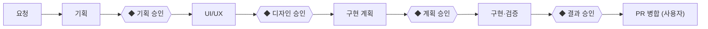

# Claude Code 웹앱 템플릿

> 대상: 사람

Claude Code로 웹 서비스를 만들 때 쓰는 프로젝트 시작 템플릿입니다.

사용자는 요구사항을 주고 결정만 합니다.

기획·디자인·구현·검증은 역할이 나뉜 AI 에이전트들이 순서대로 맡습니다.

단계마다 사용자가 승인해야 다음 단계로 넘어갑니다.

그래서 AI가 "다 됐습니다"라고 해도 무엇을 기준으로 끝났는지 확인할 수 있습니다.

- **이런 분께 맞습니다**
  - 혼자 또는 작은 팀으로 웹 서비스를 만들면서, AI에게 일을 크게 맡기되 방향과 품질은 직접 통제하고 싶은 분
- **아직 들어 있지 않은 것**
  - 앱 코드. 언어·프레임워크는 프로젝트마다 달라서 3단계(구현 준비)에서 정하고 그때 뼈대를 만듭니다.
- **확인한 환경**
  - macOS, Claude Code CLI 2.1.332 (2026-11-28)

> 이 저장소로 새 프로젝트를 만들면, 새 저장소의 README는 그 프로젝트 소개로 바꿉니다.
>
> 방법은 [SETUP.md](docs/guide/SETUP.md) 2단계에 있습니다.

## 무엇이 들어 있나

| 구성 | 내용 | 위치 |
|---|---|---|
| 작업 규칙 | AI가 매 세션 읽는 프로젝트 규칙<br>(역할, 단계와 승인, 문서 담당, Git·시크릿 규칙) | [CLAUDE.md](CLAUDE.md) |
| 에이전트 9개 | 기획, 디자인, 프론트엔드, 백엔드, QA,<br>코드 리뷰, AI 코드 보안, 위협 모델링, 접근성 | `.claude/agents/` |
| 명령 3개 | `/refine` 요청 구체화<br>`/plan-work` 단계 판정과 작업 계획<br>`/tool-review` 도구 재검토 | `.claude/commands/` |
| 안전장치 | 위험 명령 차단 훅, 테스트 점검 훅,<br>시크릿 커밋 차단(gitleaks), 권한 규칙 | `.claude/hooks/`<br>`.claude/settings.json` |
| 기준 문서 양식 | 요구사항, 아이디어, 스펙 작성 기준,<br>화면 설계, 디자인 시스템,<br>기술 스택, 아키텍처, DB, 배포, 결정 기록(ADR) | `docs/` |
| 사용자용 안내서 | 설치 순서, 구성원과 흐름, 단계별 프롬프트,<br>요청 작성법, 운영 체크리스트 | `docs/guide/` |
| 외부 도구 | Spec Kit(스펙 작성), UI UX Pro Max(디자인 지식),<br>Playwright·Figma MCP | [도구 목록](docs/engineering/tool-catalog.md) |

## 일하는 방식

순서는 **기획 → UI/UX 디자인 → 구현**입니다.

◆에서 사용자가 승인해야 다음으로 넘어갑니다.



| 단계 | 사용자가 하는 일 | AI가 하는 일 |
|---|---|---|
| 요청 | 만들고 싶은 것을 말한다 | 원문을 기록하고, 빈칸을 질문으로 채워 요청서를 만든다(`/refine`) |
| 기획 | 질문에 답하고<br>**기획 승인** | 기획 에이전트가 요구사항을 분석해 스펙과 인수 기준(완료 판정 기준)을 쓴다.<br>승인 전에 리뷰 에이전트가 대화 맥락 없이 스펙만 읽고 빈틈을 찾는다 |
| UI/UX | HTML 시안을 보고 의견을 준 뒤<br>**디자인 승인** | 디자인 에이전트가 화면 구조·흐름·디자인 시스템을 설계하고 시안을 만든다 |
| 계획 | **계획 승인** | 총괄(메인 세션)이 작업을 나누고 담당 에이전트를 정한다(`/plan-work`) |
| 구현·검증 | 지켜본다 | 백엔드·프론트엔드 에이전트가 만든다.<br>QA·리뷰·디자인·접근성·보안 에이전트가 동시에 검증한다 |
| 결과 | **결과 승인** 후<br>PR 병합 | 검증 결과를 하나로 묶어 보고하고 PR을 만든다.<br>병합은 하지 않는다 |

결정은 항상 사용자가 합니다.

MVP 범위, 기술 스택, 디자인, 배포, 유료 서비스, 새 도구 설치가 여기에 들어갑니다.

AI는 선택지와 근거를 정리해 [docs/PIPELINE.md](docs/PIPELINE.md)의 "사람 확인 대기"에 올립니다.

## 빠르게 시작하기

**필요한 것**

- [Claude Code](https://claude.com/claude-code) CLI (2.1.332에서 확인)
- GitHub 계정과 [gh](https://cli.github.com/)
- Homebrew, python3 3.9 이상
- Node.js (MCP 실행용)

**1. 새 저장소 만들기**

이 저장소는 GitHub 템플릿 저장소입니다.

아래 명령은 이 저장소의 git 이력 없이 내 저장소를 만들고 내려받습니다.

```bash
gh repo create <프로젝트-이름> --template trustnloveu/claude-webapp-template --public --clone
```

**2. 환경 준비**

[docs/guide/SETUP.md](docs/guide/SETUP.md)를 1단계부터 따라갑니다.

전역 도구 설치 → 브랜치 정리와 보호 → 프로젝트 도구 확인 → MCP 연결 → 동작 확인 순서입니다.

**3. 첫 요청**

새 저장소 폴더에서 Claude Code를 열고, 만들고 싶은 것을 생각나는 대로 적습니다.

```text
/refine 동네 미용실 예약 사이트를 만들고 싶어. 손님이 날짜와 시간을 고르고 전화번호로 예약해.
```

AI가 결정할 것을 라운드별로 묻습니다. 질문마다 추천 답이 붙어 있습니다.

답을 마치면 정리한 요청서를 보여 주고, 확인하면 `/plan-work`로 어느 단계부터 할지 정합니다.

**4. 진행 상황 보기**

[docs/PIPELINE.md](docs/PIPELINE.md)에 현재 단계, 다음 할 일, 사용자가 승인할 항목이 있습니다.

새 세션을 열면 AI가 이 파일부터 읽고 요약합니다.

단계마다 붙여 넣어 쓰는 프롬프트는 [docs/guide/prompts/](docs/guide/prompts/README.md)에 있습니다.

## 폴더 구조

| 경로 | 내용 |
|---|---|
| `CLAUDE.md` | AI가 따르는 프로젝트 규칙 |
| `.claude/` | 에이전트, 명령, 훅, 권한 설정 |
| `apps/web`, `apps/api` | 프론트엔드·백엔드 (3단계에서 뼈대 생성) |
| `packages/shared` | OpenAPI에서 생성하는 API 타입 (직접 수정 금지) |
| `specs/` | 기능별 스펙 (Spec Kit 기본 위치) |
| `docs/` | 기준 문서. [docs/README.md](docs/README.md)가 문서 지도입니다 |
| `docs/guide/` | 사용자용 안내서 |

### 파일마다 읽는 대상이 정해져 있습니다

파일 제목 아래 `> 대상:` 표시를 보면 누구를 위한 파일인지 알 수 있습니다.

"사람"은 사용자를 뜻합니다.

| 대상 | 파일 | 성격 |
|---|---|---|
| **AI** | `CLAUDE.md`, `apps/*/CLAUDE.md`,<br>`.claude/`, `.mcp.json` | AI가 따르는 지시문.<br>규칙을 바꿀 때만 고치고, 고친 뒤 새 세션에서 확인합니다 |
| **공용** | `docs/PIPELINE.md`, `docs/planning/`, `specs/`,<br>`docs/design/`, `docs/engineering/`, `docs/decisions/`,<br>`docs/reports/`, `docs/requests/` | 프로젝트의 사실과 결정.<br>결정은 사용자가, 정리는 AI가 합니다 |
| **사람** | `README.md`, `docs/guide/`, `.github/` 템플릿 | 사용자가 읽는 안내서.<br>AI는 이 안의 문장을 지시로 따르지 않습니다 |

AI에게 안내서대로 하게 하려면 내용을 붙여 넣거나, "docs/guide/…대로 해"라고 직접 가리킵니다.

## 안전장치

| 처리 | 대상 |
|---|---|
| **차단**<br>(실행되지 않음) | `.env` 읽기, 강제 푸시,<br>보호 브랜치(`dev`, `prd`, `main`, `release/*`)에 커밋·푸시,<br>위험한 삭제 명령, 시크릿이 든 커밋 |
| **실행 전 승인 요청** | PR 병합, 릴리스 태그, 패키지 설치, 배포 명령 |
| **한 번 멈추고 확인** | 코드를 바꾸고 테스트 없이 작업을 끝내려 할 때 |

auto 모드(승인 없이 자동 실행)에서는 승인 요청이 뜨지 않습니다.

설치·배포·병합이 있는 작업은 기본 모드에서 합니다.

## 더 읽을거리

| 알고 싶은 것 | 문서 |
|---|---|
| 구성원(총괄 + 에이전트 9개)과 흐름 | [docs/guide/roles.md](docs/guide/roles.md) |
| 요청을 잘 쓰는 법 | [docs/guide/request-guide.md](docs/guide/request-guide.md) |
| 사용자가 챙길 일과 결정 목록 | [docs/guide/operations.md](docs/guide/operations.md) |
| 에이전트를 더하거나 뺄 때 | [docs/guide/agents.md](docs/guide/agents.md) |
| 쓰는 도구와 후보, 교체 기준 | [docs/engineering/tool-catalog.md](docs/engineering/tool-catalog.md) |
| 이 템플릿을 만들며 정한 결정 | [docs/PIPELINE.md](docs/PIPELINE.md)의 결정 로그 |

## 라이선스

이 템플릿은 [MIT 라이선스](LICENSE)입니다. 자유롭게 쓰고 고치고 배포할 수 있으며, 저작권 표시와 라이선스 문구를 남기면 됩니다.

저장소에 들어 있는 외부 파일(Spec Kit, UI UX Pro Max, Agency Agents)은 MIT 라이선스입니다.

고지는 [THIRD_PARTY_NOTICES.md](THIRD_PARTY_NOTICES.md)에 있습니다.
