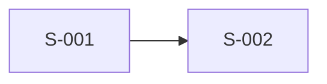

# UX 설계 (IA · 화면 목록 · 화면 흐름 · 화면 상세)

> 대상: 공용
> 작성: Agent 02 디자인(designer) · 확정: 사람(디자인 승인)
> 기준: 승인된 스펙(specs/)의 기능 명세와 사용자 시나리오. 스펙에 없는 기능은 화면에 넣지 않습니다.
> 시각 디자인(컨셉, 토큰, 시안 상태)은 docs/design/README.md에 있습니다.

## 정보 구조(IA)
```text
<1Depth 메뉴>
├─ <2Depth 메뉴> — <역할> (F-001, F-002)
│  └─ <3Depth 기능>
└─ <2Depth 메뉴>
```

## 화면 목록
| 화면 ID | 화면명 | 목적 | 관련 기능 ID | 사용자 액션 | 연결 화면 | 필요한 데이터 | 권한 |
|---|---|---|---|---|---|---|---|
| S-001 | | | | | | | |

### 기능 ↔ 화면 대응
| 기능 ID (Must) | 수행 화면 | 비고 |
|---|---|---|

## 화면 흐름

사용자 시나리오(기획)는 스펙에, 화면 간 이동(디자인)은 여기에 둡니다.

## 화면 상세
화면마다 아래 형식으로 씁니다. 구현 에이전트는 이 내용과 결정된 시안(docs/design/mockups/)대로 만듭니다.

### S-001 <화면명>
- 영역 구성: <상단·본문·하단에 무엇이 어떤 순서로 오는지>
- 컴포넌트: <사용하는 공통 컴포넌트>
- 상태: 기본 / 로딩 / 빈 상태 / 에러 / 권한 없음 — 각각 보이는 것
- 인터랙션: <클릭·입력·전환 시 동작>
- 입력 검증 메시지: <필드별 메시지>
- 반응형: <브레이크포인트별 변화>
- 접근성: <키보드 순서, 라벨, 대비>
- 시안 요청문: <Stitch 탐색과 HTML 시안 작성의 기준이 되는 문장>
