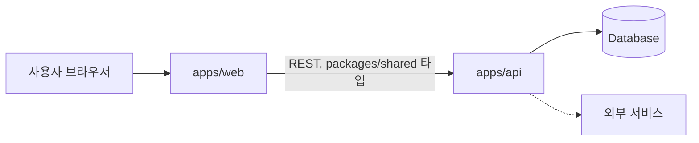

# 아키텍처

> 대상: 공용

> 작성: 총괄(메인 세션) · 승인: 사람. 스택과 패턴은 docs/engineering/tech-stack.md, 선택 이유는 ADR에 있습니다.
> 3단계에서 ADR-001(스택)을 정한 뒤 채웁니다. MVP에 필요한 구성 요소만 적습니다.

## 전체 구성

## 구성 요소
| 구성 요소 | 기술 | 역할 | 배포 위치 |
|---|---|---|---|
| apps/web | | | |
| apps/api | | | |
| Database | | | |

## 인증과 권한
<인증 방식, 토큰·세션 보관 위치, 권한 모델(역할)>

## 외부 서비스와 AI 연동
| 서비스 | 용도 | 호출 위치(서버만) | 비용 상한 |
|---|---|---|---|

## 환경
| 환경 | 용도 | 데이터 |
|---|---|---|
| 로컬 | 개발 | 시드 데이터 |
| 스테이징 | 검증 | 테스트 데이터 |
| 운영 | 서비스 | 실제 데이터 |

## 운영
배포 방식, 롤백, 백업·복구, 모니터링은 [deploy.md](deploy.md)에 적습니다. 출시(5단계) 전까지 네 가지가 모두 채워져 있어야 합니다.
