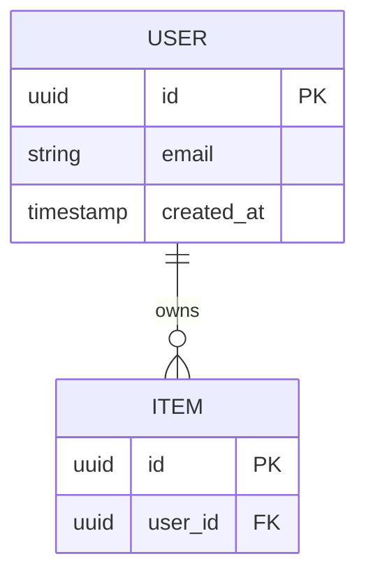

# 데이터베이스

> 대상: 공용

> 작성: Agent 04 백엔드(backend-dev) · 확인: 총괄, 구조 변경은 사람 승인
> 실제 스키마의 기준은 마이그레이션 파일입니다. 이 문서는 마이그레이션이 바뀔 때 함께 갱신합니다.

## ERD

## 테이블
| 테이블 | 역할 | 관련 기능 ID |
|---|---|---|

## 인덱스
| 테이블 | 컬럼 | 이유(어떤 조회) |
|---|---|---|

## 무결성·보안 규칙
- <예: 삭제 시 연관 데이터 처리 방식, 개인정보 컬럼 암호화 여부>
