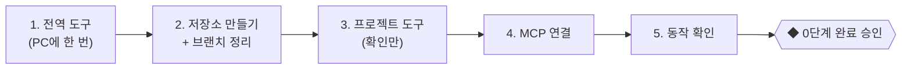
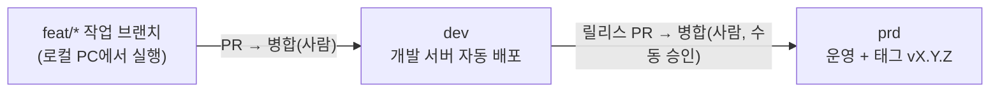
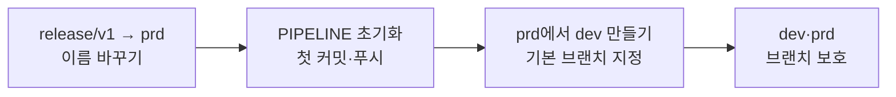

# 템플릿 사용법

> 대상: 사람

「Claude 개발 환경 설계안」과 「개발 파이프라인 가이드」의 0단계(환경)를 이 순서로 진행합니다.
아래 명령은 2026-11-27에 실제로 실행해 확인한 것입니다. 오래 지났으면 실행 직전에 각 저장소 README에서 최신 명령인지 다시 확인합니다.
외부 스킬·에이전트·MCP는 설치 전에 내용(`SKILL.md`, 에이전트 파일)을 읽습니다.

## 한눈에 보기



| 단계 | 어디서 실행 | 누가 | 새로 설치 |
|---|---|---|---|
| 1. 전역 도구 | Claude Code 세션(플러그인), 터미널(brew·npx) | 나 | 있음 (이미 설치한 PC면 건너뜀) |
| 2. 저장소 만들기 | 터미널 | 나 (보호 브랜치라 Claude는 못 함) | 없음 |
| 3. 프로젝트 도구 | — | 나 (있는지 확인만) | 없음 (`uv`만 필요하면 설치) |
| 4. MCP 연결 | Claude Code (처음 사용 시 인증·승인) | 나 | 없음 |
| 5. 동작 확인 | Claude Code 세션 | 나 + Claude | 없음 |

## 1. 전역 도구 (PC에 한 번만)

이미 설치한 PC면 건너뜁니다. 필요한 것: Claude Code CLI 2.1.142 이상(humanizer 요구), Homebrew, gh, python3 3.9 이상(위험 명령 훅).

Claude Code 세션 안에서 실행합니다.

```text
/plugin marketplace add cathrynlavery/diagram-design
/plugin install diagram-design@diagram-design
/plugin marketplace add blader/humanizer
/plugin install humanizer@humanizer
```

터미널에서 실행합니다.

```bash
# gh(GitHub CLI), pre-commit
brew install gh pre-commit

# Context7 (라이브러리 최신 문서 참조) — 로그인과 API 키 설정을 안내에 따라 직접 진행
npx ctx7 setup

# ccusage (토큰 사용량 확인) — 설치 없이 실행만, 사용 통계 전송 끔
DO_NOT_TRACK=1 npx ccusage@latest
```

- [ ] 전역 `~/.claude/CLAUDE.md`에 개인 규칙 작성(응답 언어, 커밋 스타일, 선호 스택)
- [ ] 상태줄에 컨텍스트 사용률 표시(ccstatusline 등)

superpowers는 설치하지 않습니다. 자동으로 실행되는 스킬(brainstorming, writing-plans, TDD)이 `/refine`·`/plan-work`·planner와 겹치기 때문입니다(템플릿 결정 로그 2026-11-27).

## 2. 저장소 만들기

템플릿 저장소(`trustnloveu/claude-webapp-template`)는 GitHub "Template repository"로 설정되어 있습니다. 아래 명령은 템플릿의 git 이력 없이 새 저장소를 만들고 내려받습니다.

```bash
gh repo create <프로젝트-이름> --template trustnloveu/claude-webapp-template --public --clone
cd <프로젝트-이름>
```

- `--public` 대신 `--private`도 됩니다. 단, 무료 계정의 비공개 저장소는 브랜치 보호를 쓸 수 없는 것으로 보입니다(추정, 유료 Pro 필요). 보호가 필요하면 공개로 만들거나 Pro를 씁니다.
- 폴더를 `cp -R`로 복사하지 않습니다. 템플릿의 git 이력과 개인 설정 파일(`.claude/settings.local.json`)까지 복사됩니다.

### 브랜치 정리 (복사 직후, 내 터미널에서)
복사본은 템플릿의 기본 브랜치 `release/v1` 하나만 가져옵니다. 복사본은 아래 3개 환경으로 나눠 씁니다.

| 환경 | 브랜치 | 배포 |
|---|---|---|
| 로컬 | `feat/*` 등 작업 브랜치 (내 PC에서 실행, 브랜치를 따로 두지 않음) | 없음 |
| 개발 | `dev` (기본 브랜치, PR이 향하는 곳) | `dev` 병합 시 개발 서버에 자동 |
| 운영 | `prd` | `dev` → `prd` 릴리스 PR 병합 시(수동 승인), 태그 `vX.Y.Z`로 버전 표시 |



복사 직후에는 아래 순서로 진행합니다(1~3은 아래 명령, 보호 설정은 체크 목록).



아래 명령은 Claude가 아니라 내가 직접 실행합니다(Claude의 훅은 `dev`·`prd`·`release/*` 커밋과 푸시를 막습니다). 브랜치 보호를 켜기 전에 실행합니다.

1. `release/v1`을 `prd`로 이름 바꾸기 (GitHub과 내 PC 둘 다)

```bash
gh api -X POST "repos/{owner}/{repo}/branches/release%2Fv1/rename" -f new_name=prd
```

```bash
git fetch origin --prune && git branch -m release/v1 prd && git branch -u origin/prd prd
```

2. PIPELINE을 초기 상태로 바꾸고 첫 변경을 올립니다.

```bash
cp docs/PIPELINE-template.md docs/PIPELINE.md
git rm -q docs/PIPELINE-template.md
pre-commit install
git add docs/PIPELINE.md
git commit -m "chore: PIPELINE 초기화"
git push
```

`docs/PIPELINE.md` 맨 위의 복사 안내 주석은 이때 지워도 되고, 나중에 Claude에게 지우라고 해도 됩니다.

3. `prd`에서 `dev`를 만들어 올리고 기본 브랜치로 지정합니다.

```bash
git switch -c dev && git push -u origin dev
```

```bash
gh repo edit --default-branch dev && git remote set-head origin -a
```

- [ ] `gh repo view --json defaultBranchRef`가 `dev`이고, `git branch -a`에 `release/v1`이 없는지 확인
- [ ] `.claude/hooks/block-dangerous.sh`와 `check-tests-on-stop.sh`에 실행 권한이 있는지 확인(`ls -l`에 `x`). 없으면 `chmod +x .claude/hooks/*.sh`
- [ ] `dev`·`prd` 브랜치 보호: GitHub 저장소 Settings → Rules → Rulesets에서 대상 브랜치 `dev`, `prd`에 PR 필수(승인 수 0), 예외 없음(관리자 포함), 강제 푸시·삭제 금지. CI 통과 조건은 CI를 만든 뒤 추가
- [ ] `pre-commit autoupdate`는 최신 릴리스보다 낮은 버전으로 올릴 때가 있습니다. 실행했다면 gitleaks 릴리스 페이지의 최신 버전과 비교합니다

## 3. 프로젝트 도구 (템플릿에 이미 포함)

아래 도구는 템플릿 안에 들어 있어 새로 설치하지 않습니다. 있는지만 확인합니다.

- [ ] Spec Kit v1.4.5: `.specify/`와 스킬 `.claude/skills/speckit-*` 9개. 기획용(`/speckit-specify`, `/speckit-clarify`, `/speckit-checklist`)만 씁니다. 실행할 때 `uv`(`brew install uv`)가 필요합니다
- [ ] UI UX Pro Max v2.15.0: `.claude/skills/ui-ux-pro-max`
- [ ] Agency Agents 3개: `.claude/agents/`의 security-auditor(07), appsec-engineer(08), a11y-auditor(09). 출처는 `THIRD_PARTY_NOTICES.md`

이 폴더들은 `.claude/settings.json`에서 Claude의 수정이 막혀 있습니다. 업그레이드할 때만 아래 명령을 쓰고, 바뀐 내용을 읽은 뒤 PR로 올립니다.

```bash
# Spec Kit (uv 필요). 버전을 바꾸려면 @v1.4.5 부분을 바꿉니다
uvx --from git+https://github.com/github/spec-kit.git@v1.4.5 specify init --here --force --integration claude --script sh --non-interactive

# UI UX Pro Max
gh skill install nextlevelbuilder/ui-ux-pro-max-skill .claude/skills/ui-ux-pro-max --agent claude-code --scope project --pin v2.15.0
```

- Spec Kit은 버전마다 옵션과 폴더가 바뀝니다. 업그레이드 전에 빈 폴더에서 먼저 실행해 보고, `CLAUDE.md`의 "구조"·`docs/README.md`·`specs/README.md`와 맞는지 확인합니다.
- Agency Agents는 설치 스크립트(전역 `~/.claude/agents/`에 복사)를 쓰지 않습니다. 필요한 에이전트 파일만 내용을 읽고 `.claude/agents/`에 복사한 뒤, 프로젝트 규칙 머리말을 붙이고 `THIRD_PARTY_NOTICES.md`에 고지를 추가합니다. 에이전트를 추가하면 [에이전트 관리](agents.md)대로 함께 고칠 곳을 고칩니다.

### Trail-code (보류)
코드 지도·팀 지식 도구입니다. 전역 훅 5개를 설치하고, 결정을 "학습"으로 자동 저장해 결정 로그와 겹쳐서 보류했습니다. 3단계(구현 준비)에서 코드 뼈대가 생긴 뒤 다시 검토합니다. 그때는 아래처럼 사용 통계를 끄고 미리보기부터 합니다.

```bash
DO_NOT_TRACK=1 npm install -g @trailhq/trail-code
trail init --agents claude --dry-run
```

### Claude Code Setup (선택, 코드가 생긴 뒤)
Anthropic 공식 플러그인(`anthropics/claude-plugins-official`의 `claude-code-setup`)입니다. 코드를 읽고 이 프로젝트에 맞는 훅·스킬·MCP·서브에이전트를 분야마다 1~2개 추천하며, 파일은 고치지 않습니다(읽기 전용). 템플릿에는 코드가 없어 설치하지 않았습니다. 3단계에서 코드 뼈대가 생긴 뒤 한 번 써 볼 만합니다.
- 설치는 내가 결정합니다(새 플러그인 설치는 사람 결정). Claude Code에서 `/plugin`을 열어 공식 마켓플레이스의 `claude-code-setup`을 찾습니다.
- "이 프로젝트에 맞는 자동화를 추천해 줘"라고 하면 추천 목록이 나옵니다. 추천은 바로 넣지 않고, 이미 있는 도구와 겹치는지(CLAUDE.md "같은 일을 하는 도구는 하나만") 보고 고릅니다. MCP는 켜 둔 개수 기준(5~6개)도 봅니다.

## 4. MCP 연결

`.mcp.json`에 Figma와 Playwright가 등록되어 있습니다.

- [ ] Figma (선택): HTTP 방식(`https://mcp.figma.com/mcp`). 처음 사용할 때 Figma 계정으로 인증합니다. 무료(Starter) 플랜이나 View·Collab 좌석은 MCP 읽기 도구가 월 20회로 제한되고, View 좌석에서 쓰기가 되는지는 확인되지 않았습니다. 시안을 Figma에서 다루려면 Professional 이상의 Full 또는 Dev 좌석을 검토합니다(비용 발생, 사람 결정)
- [ ] 시안은 기본적으로 Figma 없이 진행합니다. designer가 `docs/design/mockups/`에 HTML 시안을 만들고, 탐색이 필요하면 Google Stitch(stitch.withgoogle.com, 무료, MCP 연결 없이 웹에서 사용)를 씁니다. Stitch 무료 범위는 월 수백 회(공식 수치 미확인)이고 유료화될 수 있습니다. 흐름은 `docs/design/mockups/README.md`
- [ ] Playwright: `npx @playwright/mcp@latest`. 설치된 Google Chrome을 쓰므로 브라우저 추가 설치가 필요 없습니다. 실행하면 `.playwright-mcp/` 폴더가 생깁니다(.gitignore에 포함)
- [ ] 데스크탑 앱과 별개로, 터미널 CLI(`claude mcp list`)에서는 두 서버가 "승인 대기"로 나옵니다. CLI로 쓸 때 처음 한 번 승인합니다
- [ ] 백엔드 작업을 시작할 때 DB MCP(개발 DB 전용), 배포 후 Sentry MCP 추가
- [ ] 켜 둔 MCP 서버가 5~6개를 넘지 않는지 확인(claude.ai 커넥터와 앱 기본 서버도 셉니다)

## 5. 동작 확인

- [ ] Claude Code에서 `.env` 파일을 읽으라고 시키면 훅이 "차단됨"으로 막는다(파일이 없어도 됨)
- [ ] `bash .claude/hooks/test-check-tests-on-stop.sh`가 모두 통과한다(코드만 바꾸고 테스트 없이 끝내려 할 때 멈추는 훅)
- [ ] 테스트 브랜치에서 가짜 시크릿을 커밋하면 gitleaks가 막는다. 확인 뒤 파일과 테스트 브랜치를 지운다
- [ ] 새 세션에서 `docs/PIPELINE.md를 읽고 현재 단계를 요약해 줘.`라고 하면 "0. 환경"이라고 답한다
- [ ] 새 세션의 에이전트 목록에 9개(planner, designer, frontend-dev, backend-dev, qa, reviewer, security-auditor, appsec-engineer, a11y-auditor)가 보인다

모두 통과하면 Claude에게 "0단계 완료"를 승인한다고 말합니다. Claude가 `docs/PIPELINE.md`의 0단계를 체크하고 현재 단계를 1. 기획으로 바꿉니다.
`< >`로 표시된 부분은 단계를 진행하면서 채웁니다.
