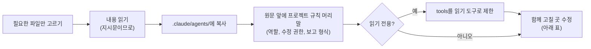

# 서브에이전트 관리

> 대상: 사람

에이전트는 9개입니다. 구성원 정보는 [프로젝트 구성원](roles.md)을 봅니다.

| 번호 | 이름 | 역할 | 쓰기 권한 | effort 기본값 |
|---|---|---|---|---|
| 01 | `planner` | 기획 | 기획 문서 | high |
| 02 | `designer` | 디자인 | 디자인 문서 | high |
| 03 | `frontend-dev` | 프론트엔드 구현 | apps/web | medium |
| 04 | `backend-dev` | 백엔드 구현 | apps/api 등 | medium |
| 05 | `qa` | 동작 테스트 | 없음 | high |
| 06 | `reviewer` | 코드 리뷰, 스펙·ADR 문서 검토(승인 전, 새 맥락) | 없음 | high |
| 07 | `security-auditor` | AI 코드 보안 | 없음 | high |
| 08 | `appsec-engineer` | 위협 모델링·보안 심층 검토 | 없음 | high |
| 09 | `a11y-auditor` | 접근성 | 없음 | medium |

- 에이전트마다 머리말의 `tools:`로 쓸 수 있는 도구를 정합니다. `tools:`가 없으면 앱의 도구를 모두 물려받아, 작업 전 기본 컨텍스트만 호출당 약 6만 토큰이 듭니다(2026-11-28 측정). 지금은 9개 모두 `tools:`가 있습니다. 도구가 필요하면 목록에 더하고, **새 세션**에서 확인합니다(에이전트 정의는 세션 시작 때 읽힘).
- effort는 에이전트가 생각에 쓰는 노력 수준입니다(low·medium·high·xhigh·max). 에이전트 파일 머리말의 `effort:`가 기본값이고, 작업마다 바꿀 때는 총괄이 계획서에 적어 승인받습니다.
- 07~09는 Agency Agents(MIT) 원문 앞에 프로젝트 규칙 머리말을 붙인 것입니다. 출처는 `THIRD_PARTY_NOTICES.md`에 있습니다.

## 에이전트를 추가하거나 뺄 때

`.claude/agents/`는 Claude Code가 서브에이전트 정의를 읽는 곳이라, 에이전트 파일 외에는 넣지 않습니다.

외부 에이전트(Agency Agents 등)는 아래 순서로 넣습니다. 설치 스크립트는 전역 `~/.claude/agents/`에 복사하므로 쓰지 않습니다.

에이전트를 추가하거나 빼면 아래를 함께 고칩니다.

| 파일 | 고칠 내용 |
|---|---|
| `CLAUDE.md` | 역할 표(필요하면 단계 표) |
| `.claude/commands/plan-work.md` | 배정 기준, 규모별 검증 표, effort 기본값 |
| 이 문서, [프로젝트 구성원](roles.md), `README.md` | 에이전트 목록과 수 |
| `THIRD_PARTY_NOTICES.md` | 외부 파일일 때 출처·라이선스 고지 |

한 달 동안 쓰지 않은 에이전트는 지웁니다.
