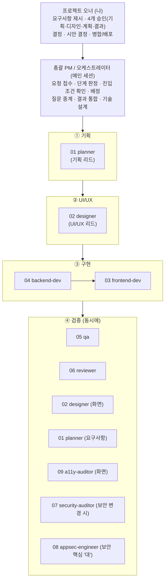
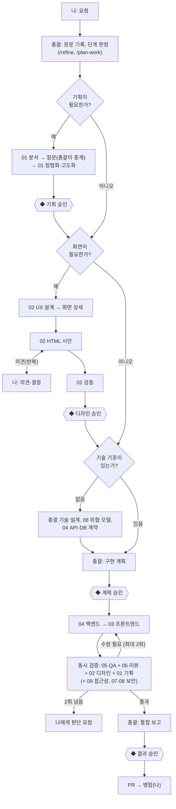

# 프로젝트 구성원과 작업 흐름

> 대상: 사람

이 프로젝트는 사람 1명, 총괄 1명(메인 세션), 에이전트 9개로 움직입니다. 01~06은 기본 구성원이고, 07~09는 보안·접근성 점검을 맡는 읽기 전용 검증 에이전트입니다.
**우선순위는 기획 → UI/UX 디자인 → 구현입니다.** 앞 단계가 승인되어야 뒤 단계가 시작됩니다.

AI가 따르는 기준은 루트 `CLAUDE.md`이고, 에이전트별 세부 규칙은 `.claude/agents/<이름>.md`에 있습니다. 구성원을 바꿀 때는 세 곳(이 문서, `CLAUDE.md`, 에이전트 파일)을 함께 고칩니다.

## 조직도

※ 08 appsec-engineer는 ③ 구현 전 "구현 준비" 단계의 위협 모델링도 맡습니다.

## 구성원

| 구성원 | 주체 | 하는 일 | 기준 문서 (작성) | 보고 대상 |
|---|---|---|---|---|
| 프로젝트 오너 | 나 | 요구사항 제시, 질문에 답, 4개 승인, 결정, 시안 의견·결정(Stitch 탐색은 선택), 외부 채널 업로드, 병합·배포 | 전부 확정 | — |
| 총괄 | 메인 세션 | 요청 접수·원문 기록, 단계 판정, 진입 조건 확인, 배정, 질문 중계, 결과 통합, 기술 설계 | `PIPELINE.md`, 요청서, `tech-stack.md`, `architecture.md`, ADR(제안) | 나 |
| **01 기획 (리드)** | `planner` | 요구사항 **분석 → 구체화 → 정형화 → 고도화**, 구현 결과의 요구사항 충족 검토 | `planning/requirements.md`, `idea.md`, `specs/` | 총괄 |
| **02 디자인 (UI/UX 리드)** | `designer` | **UX 설계(IA·화면 목록·화면 흐름) → UI 정형화(화면 상세·디자인 시스템) → HTML 시안 → 고도화**, 시안·구현 검증 | `design/ux.md`, `design/README.md`, `design/mockups/` | 총괄 |
| 03 프론트엔드 | `frontend-dev` | 승인된 기획·디자인대로 화면 구현, API 연동 | `apps/web` | 총괄 |
| 04 백엔드 | `backend-dev` | 승인된 기획대로 API·DB·서버 로직, API 계약 | `apps/api`, OpenAPI, `database.md` | 총괄 |
| 05 QA | `qa` | 인수 기준대로 동작하는지 테스트 | 없음 (보고만) | 총괄 |
| 06 코드 리뷰 | `reviewer` | 품질·보안·성능·기술 기준 리뷰, 스펙·ADR을 승인 전에 새 맥락에서 검토(문서 검토) | 없음 (보고만) | 총괄 |
| 07 AI 코드 보안 | `security-auditor` | 시크릿 노출, DB 접근 정책, 프롬프트 인젝션 점검 | 없음 (보고만) | 총괄 |
| 08 애플리케이션 보안 | `appsec-engineer` | 구현 준비 단계 위협 모델링·보안 요구사항 제안, 보안 핵심 기능 심층 검토 | 없음 (보고만) | 총괄 |
| 09 접근성 | `a11y-auditor` | 화면 구현의 WCAG 2.2 AA(웹 접근성 국제 기준) 점검 | 없음 (보고만) | 총괄 |

## 영역의 경계

| 영역 | 정하는 것 | 정하지 않는 것 | 담당 |
|---|---|---|---|
| 기획 | 무엇을, 왜, 누구를 위해 (요구사항, 기능, 사용자 시나리오, 인수 기준) | 화면 구성, 화면 모양, 기술 | 01 기획 |
| UI/UX | 어떤 화면에서 어떻게 쓰고 어떻게 보이는지 (IA, 화면 목록·흐름·상세, 디자인 시스템) | 기능 추가, 기술 | 02 디자인 (+ 시안 결정은 나) |
| 기술 | 무엇으로, 어떤 구조로 (스택, 패턴, API 계약, DB) | 기능 범위, 화면 | 총괄, 04 백엔드 |
| 구현 | 위 기준대로 코드 작성 | 기준 문서 변경 | 03, 04 |

충돌이 생기면 **앞 단계가 기준**입니다. 기획과 디자인이 다르면 기획, 디자인과 구현이 다르면 디자인을 따릅니다. 기준 자체를 바꿔야 하면 총괄이 정리해서 나에게 묻습니다.

## 단계와 승인

| 순서 | 단계 | 무엇을 하나 | 진입 조건 | 끝 (내 승인) |
|---|---|---|---|---|
| 1 | **기획** | 01이 요구사항을 분석하고 질문 → 내가 답 → 01이 스펙으로 정형화 → 01이 고도화 제안 → 06이 대화 맥락 없이 스펙만 읽고 숨은 가정·모호함 검토 | 요구사항 원문이 기록됨 | **기획 승인** |
| 2 | **UI/UX** | 02가 IA·화면 목록·흐름 설계 → 화면 상세 정형화 → 02가 HTML 시안, 내가 의견·결정 → 02가 검증·고도화 | 기획 승인 | **디자인 승인** |
| 3 | 구현 준비 | 총괄이 기술 스택·구조 제안(ADR), 08이 위협 모델, 04가 API 계약·DB 설계, 뼈대 | 기획 승인 (+ 디자인 승인) | ADR 채택 |
| 4 | 구현 계획 | 총괄이 작업을 나누고 배정 | 1~3 완료 | **계획 승인** |
| 5 | 구현 | 04 → 03 | 계획 승인 | — |
| 6 | 검증 | 05 동작, 06 코드, 02·09 화면, 01 요구사항 충족, 07·08 보안(해당 시) (동시에) | 구현 완료 | **결과 승인** → PR → 병합(나) |

### 단계 번호가 두 가지인 이유
위 표(1~6)는 **기능 하나**가 거치는 단계이고, `docs/PIPELINE.md`(0~5)와 [프롬프트 모음](prompts/README.md)은 **프로젝트 전체** 단계입니다. 대응은 아래와 같습니다.

| 프로젝트 단계 (PIPELINE) | 기능 하나의 단계 (이 표) |
|---|---|
| 0. 환경 | — (SETUP.md) |
| 1. 기획 | 1. 기획 |
| 2. UI/UX | 2. UI/UX |
| 3. 구현 준비 | 3. 구현 준비 |
| 4. 기능 구현 루프 | 기능마다 1~2 확인 → 4. 구현 계획 → 5. 구현 → 6. 검증 |
| 5. 출시 | — (5-release.md) |

- 개발 환경, 디자인 시안, 기획 내용의 검토는 **각 단계의 진입 조건과 승인에서** 확인합니다. 총괄이 단계를 시작하기 전에 진입 조건을 확인하고, 안 되면 어느 단계가 먼저 필요한지 알려 줍니다.
- 이미 승인된 범위 안의 작업(버그 수정, 승인된 화면 구현)은 1·2단계를 건너뛰고 4단계부터 합니다.
- 구현이나 검증 중에 기획·디자인의 빈틈이 드러나면 구현에서 메우지 않고 해당 단계로 돌아갑니다.

## 기능 하나의 흐름

◆ 표시는 내 승인입니다.

## 규모별로 부르는 구성원

| 규모 | 예 | 작업 | 검증 |
|---|---|---|---|
| 기획 | 요구사항 분석, 스펙 작성 | 01 | 06(문서 검토), 나 (기획 승인) |
| 디자인 | UX 설계, 화면 상세, 디자인 시스템 | 02 | 01(기획 대응), 나 (디자인 승인) |
| 소 | 문서·설정 1~2개 파일 | 총괄 | 없음 또는 06 |
| 중 | 화면만, 또는 API만 | 03 또는 04 | 05 + 06 (+ 화면이면 02 + 09) |
| 대 | 화면 + API | 04 → 03 | 05 + 06 + 02 + 09 + 01 |
| 기술 설계 | 스택 비교, 구조 정의 | 총괄 (+ 위협 모델은 08) | 06(문서 검토), 나 (ADR 채택) |

규모와 관계없이 아래 조건이면 보안 에이전트를 더합니다.

| 조건 | 더하는 에이전트 |
|---|---|
| 인증·권한·시크릿·DB 정책·AI 호출이 바뀜 | 07 security-auditor |
| 인증·결제·개인정보 같은 보안 핵심 기능의 "대" 작업 | 07 + 08 appsec-engineer |

- 에이전트마다 생각에 쓰는 노력 수준(effort) 기본값이 있습니다. 기획·디자인·검증은 high, 구현(03·04)과 09는 medium입니다. 작업에 따라 바꿀 필요가 있으면 총괄이 계획서에 적고 내가 승인합니다.

## 꼭 알아 둘 것

- **질문은 총괄을 통해 옵니다.** 에이전트는 나에게 직접 묻지 못합니다. 특히 기획 단계에서는 질문이 많을 수 있는데, 총괄이 모아서 중요한 것부터 묻습니다.
- **시안은 02가 HTML로 만들고, 내가 보고 결정합니다.** 아이디어 탐색은 내가 Stitch(무료)로 할 수 있고, 결정된 시안의 PNG를 외부 채널(Stitch 또는 Figma)에 올리는 것도 내가 합니다. Figma는 유료 좌석을 쓸 때의 선택지입니다. 흐름: `docs/design/mockups/README.md`
- **고도화 제안은 바로 만들지 않습니다.** `docs/planning/requirements.md`의 "고도화 제안"에 모이고, 내가 채택한 것만 기획 단계부터 다시 진행합니다.
- **토큰 사용량:** 규모 "대"는 에이전트가 6~8번 호출됩니다. [운영 체크리스트](operations.md)대로 매주 확인합니다.
- **줄이고 싶을 때:** 03·04를 합치거나, 규모 "중"에서 06을 빼도 됩니다. 07~09는 해당 작업에서만 부릅니다. 01·02는 줄이지 않는 것을 권합니다.
